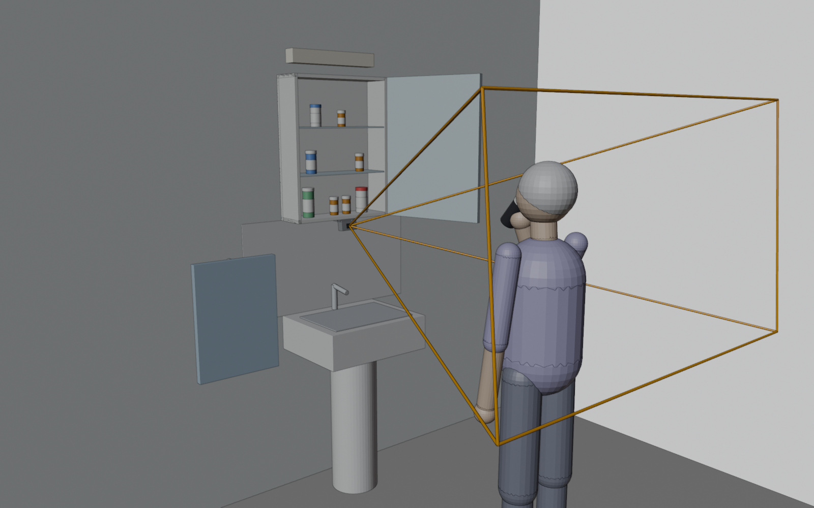
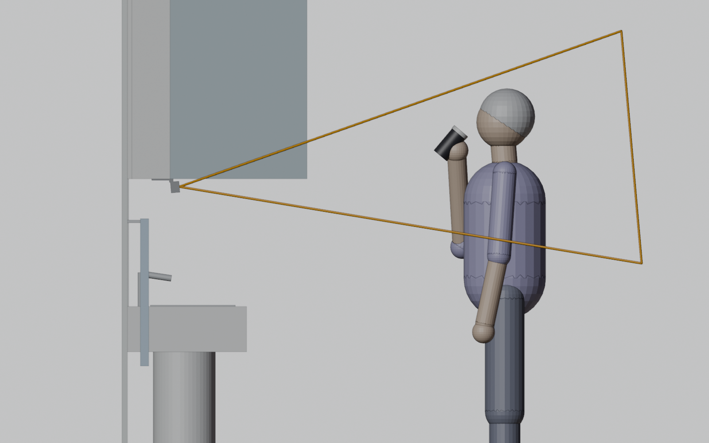
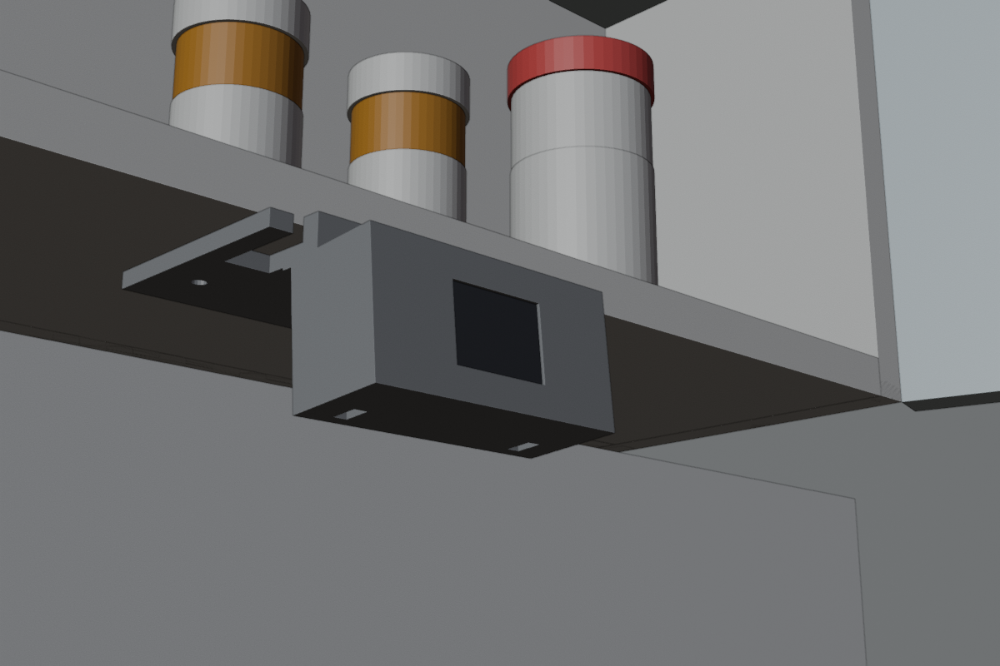

# Squint demo rig: medicine cabinet + Logitech C270



A bathroom set: a wall medicine cabinet (mirror door open, shelves of bottles) above a pedestal sink.
The **C270 hangs under the cabinet's front edge** in one printed mount, tilted 5° up, looking
at Margaret standing on the bath mat. The orange lines show what the camera sees.

| What vision gets (960x544) | Side view |
|---|---|
|  |  |

Everything comes from one script. Change a number at the top and rebuild:

```bash
blender -b -P rig/build_rig.py
```

It prints where her nose, mouth, eyes, shoulders and hands land in the 960x544 image, and fails
the check if any of them is out of frame.

## Key numbers

| | |
|---|---|
| Camera | Logitech C270, 55° diagonal: **~49° x 29°** at camstream's 960x544. Lens 1.27 m off the floor, tilted **5° up** |
| Cabinet | 500 W x 650 H x 150 D mm, bottom edge 1.30 m off the floor |
| Margaret | Stands **~1.05 m** from the lens (the bath mat). Nose at y≈160/544, shoulders y≈340, a bottle held at the chest y≈480 |

**Why she stands that far back:** the C270 is narrow (only ~29° tall). The intake model needs
her nose, mouth, both shoulders and the hand on its way up all in frame. That only fits from about
1 m, which is also what the model was trained for (0.9–1.4 m). Closer than ~0.9 m, the chest
hand drops out of the bottom of the image. Put a mat or tape mark at 1 m.

## The printed part: `stl/c270_mount.stl`



- About 101 x 100 x 50 mm. The plate screws to the underside of the cabinet with 2 small wood screws, and the sleeve hangs in front of the edge, already tilted 5° up.
- Fold the C270's clip flat against its back (or pop it off), slide the camera in from the back,
  and put a zip tie through the two slots.
- The pocket is sized for a 73 x 32 x 28 mm body with 0.8 mm clearance. **Measure your C270** and
  change `C270` at the top of the script if it differs.
- PLA, 0.2 mm, 20% infill. The STL is exported plate-down, so it needs no supports except a little under the lens window.

## Building the set for the demo

- **Cabinet:** any cheap surface-mount medicine cabinet (~$30–40), or a foam-board box at the size above.
  Mount it on a sheet of foam board or plywood standing on a table if there's no wall. Keep the bottom edge
  about 1.3 m off the floor, roughly face height minus 25 cm.
- **Bottles:** the ones Dinu enrolled (Omega 3-6-9, Tylenol) plus a few pharmacy vials as clutter.
- **Light:** a USB LED bar above the cabinet (the "vanity light" in the model) lights her face evenly.
  No window behind her.
- **Live:** she takes a bottle from the shelf, steps back onto the mat, and raises it to her mouth.
- **Video:** phone on a tripod at 45° (like `renders/hero.png`), plus a screen recording of the vision window.
