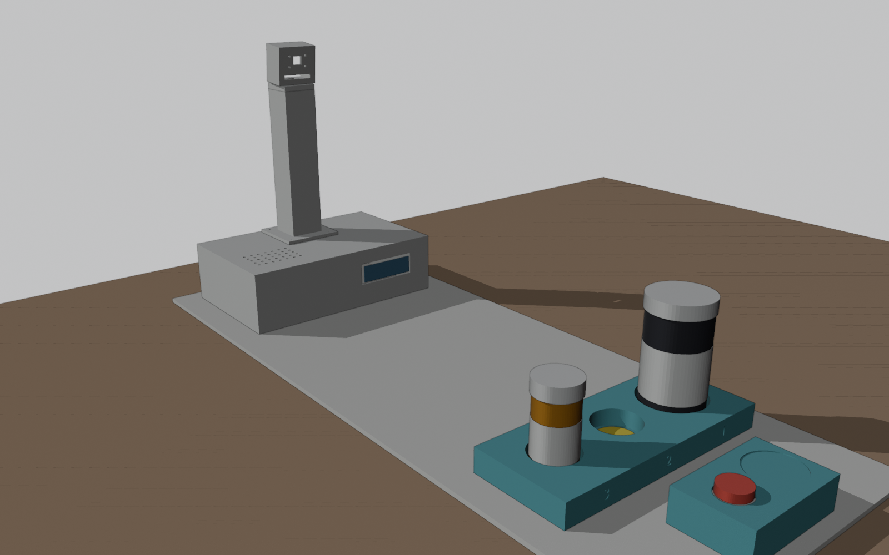
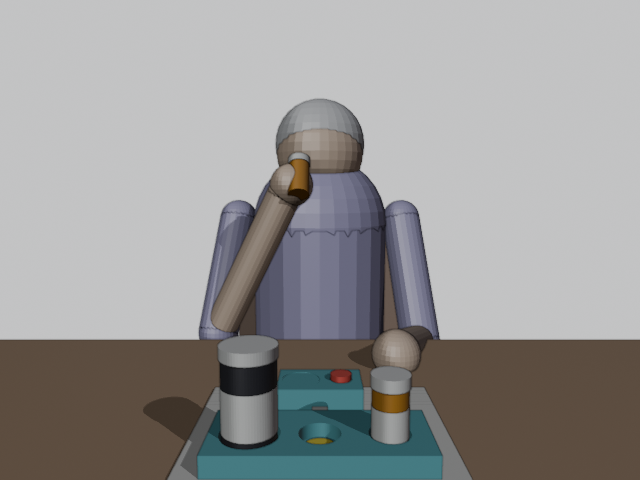

# Squint station rig



The camera sits **behind the bottles**. Each bottle lives in its own numbered slot on a shelf.
When a slot goes empty, we know which bottle she picked up, and we never need to see its
label. The same camera still sees her head, shoulders and hands for the intake model.

| Camera view (640x480, what vision gets) | Side view (orange = what the camera sees) |
|---|---|
|  |  |

Everything is generated by one script, so change a number and rebuild:

```bash
blender -b -P rig/build_rig.py
```

The script checks that her mouth, nose, head, shoulders, hands and every slot floor land
inside the 640x480 image. It also writes `slots_default.json` (each slot's pixel box) and
the STLs, renders and `squint_rig.blend`.

## Key numbers

| | |
|---|---|
| Camera | Pi Camera Module 3, standard lens (~66° wide at 640x480), lens 284 mm above the table, tilted **6° down** |
| Shelf | 365–465 mm in front of the camera. Pockets: slot 1 Ø66 (the omega-3 bottle), slots 2–3 Ø46 (pharmacy vials), 16 mm deep |
| Margaret | Seated across the table, face **~1.0 m** from the lens (the intake model is trained for 0.9–1.4 m) |
| Footprint | 300 x 760 mm foam board (all parts glue onto it, so the slots never move relative to the camera) |

In the camera image, the slots land at y ≈ 420–465 (bottom strip), her face at y ≈ 105–170,
and her shoulders at y ≈ 220.

## Parts to print (`stl/`)

| Part | Size (mm) | Notes |
|---|---|---|
| `base.stl` | 240 x 150 x 70 | Open bottom; Pi, speaker, wiring inside. LCD window (16x2) faces Margaret; speaker grille on top; USB/power hole at the back |
| `tower.stl` | 70 x 70 x 180 | 18 mm cable channel for the camera ribbon; 4x M3 flange screws into the base |
| `tilt_wedge_6deg.stl` | 40 x 40 x 10 | Sets the tilt. Change `CAM_TILT` and rebuild for a different angle |
| `camera_head.stl` | 48 x 30 x 44 | Camera Module 3 slides in from the back (M2 holes 21 x 12.5 mm). Slot under the lens for a small LED bar |
| `shelf.stl` | 240 x 100 x 24 | 3 numbered pockets. **Print in a dark colour** |
| `nfc_button_pod.stl` | 110 x 70 x 32 | 30 mm arcade button + NFC tap dish, on Margaret's side |

PLA, 0.2 mm layers, 15% infill, no supports needed except the LCD window. The base is
240 mm long: it fits a Prusa MK4 or Bambu bed. On a 220 mm bed, print it rotated 45°.

## Things that make the slot detection easy

- **A bright yellow sticker on each pocket floor** (dark shelf, yellow dot). An empty slot is then a big
  yellow circle, so "empty vs full" is trivial even in bad light.
- **Glue everything to the board.** The slot pixel boxes in `slots_default.json` only hold if the
  shelf can't move relative to the camera. Re-measure them on the real rig (a calibration tool is next).
- **Light from the camera side.** A USB LED bar in the head slot lights her face and the shelf.
  Never put her in front of a bright window.

## Demo setup

- **Live:** the rig at the back edge of a table, a chair ~1 m in front of the camera (tape the floor), plain wall
  or a foam board behind her. Run vision where the bus works: everything on the Pi, or the laptop reading the
  Pi's stream with every other program on the laptop too.
- **Video:** same rig. Phone on a tripod from the side, plus a screen recording of the vision window
  (skeleton, slot boxes, STOP with its lead time). Do at least 5 takes per checklist item.
