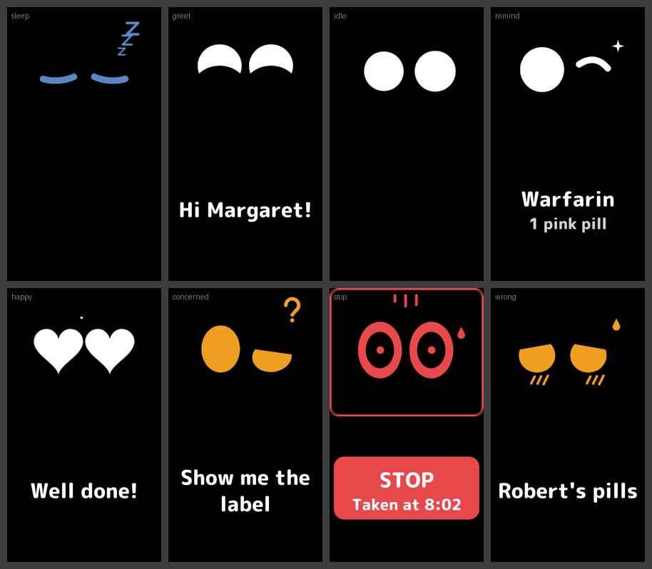

# Otto-eyes face for the M5Stack Tab5

This sketch shows the companion's face on an **upright** Tab5 (720 × 1280).

- **Face zone (top 600 px):** animated Otto eye GIFs. The eye colour shows the meaning: white = all good, amber = check this, red = STOP, dim blue = sleep.
- **Text zone (middle of the body):** a few words in a big, rounded, extra-bold font.
- **Asleep by default.** It wakes when a person approaches or when a dose is due.

## Sleep and wake

| Event | What happens |
|---|---|
| Power on | Asleep: the eyes close once and stay closed, "z" floats up, the screen dims. |
| `presence` (a person approaches) or a tap on the screen | If asleep: wakes, says hello ("Hi there!", or "Hi Margaret!" with `presence Margaret`). If awake: stays awake longer. |
| `remind ...` (a dose is due) | Wakes and shows the pill. Stays awake until the Pi sends the next event. |
| `away` (the person left) | If idle: sleeps after 10 s. A reminder or STOP is not cut short. |
| Nothing for 1 min while idle | Falls asleep. |

The Pi sends `presence` and `away` from its ultrasonic sensor (or the camera when it sees a face).
Change the times in `Reactions.h` (`kAwakeMs`, `kAfterAwayMs`) and the brightness in `tab5-face.ino` (`kAwakeBrightness`, `kSleepBrightness`).

 

These images come from the desktop preview. They are not from the Tab5.

## Reactions

| Reaction | When to use it | Otto GIF | Colour | Default words | Stays for |
|---|---|---|---|---|---|
| `sleep` | Default; nobody near | fall_asleep, then asleep (eyes stay closed) | dim blue | (none) | Until woken |
| `idle` | Awake, nothing is happening | neutral (looks around, blinks) | white | (none) | 1 min, then sleep |
| `greet` | Face recognised | happy | white | "Hi there!" | 6 s |
| `remind` | A dose is due | winking | white | "Pill time" | Until the next event |
| `happy` | Green verdict | loving (heart eyes) | white | "Well done!" | 6 s |
| `concerned` | Amber verdict (unknown bottle, fault) | confused (question mark) | amber | "Show me the label" | 12 s |
| `stop` | Red verdict / STOP | shocked + flashing red frame | red | "STOP" / "Already taken" | 30 s or until the next event |
| `wrong` | Another person's bottle | embarrassed (eyes look away) | amber | "Not your pills" | 10 s |

Timed reactions go back to `idle`. `idle` goes back to `sleep`.

Each GIF loop starts and ends on the neutral eyes, so a change of reaction looks smooth.
The screen shows only the key words. The voice clip says the full sentence.

## Files

| File | Purpose |
|---|---|
| `tab5-face.ino` | Setup, loop, serial commands, tap-to-cycle, demo script |
| `OttoFace.h` | Plays the GIFs in the face zone, colours them, STOP frame |
| `TextPanel.h` | The words in the body |
| `Reactions.h` | The reaction state, and the sleep / wake rules |
| `Voice.h` | Plays voice clips from LittleFS |
| `AUDIO_PACK.md` | Clip names, format and words for the Gemini audio pack |
| `src/gifs/` | The 9 Otto GIFs (480 px), embedded as C arrays (about 900 KB of flash) |
| `src/fonts/` | M PLUS Rounded 1c ExtraBold, at 96 px and 72 px (SIL OFL 1.1) |
| `tools/otto/` | Otto GIF generator (MIT, from [txp666/otto-emoji-gif-component](https://github.com/txp666/otto-emoji-gif-component)), with a size setting and two added expressions: `fall_asleep` and `asleep` |
| `tools/gif_to_header.py` | Turns GIFs into the C arrays in `src/gifs/` |
| `tools/make_vlw.py` | Makes a new font size from a TTF file |
| `preview/` | Desktop preview (SDL). It compiles the same sketch |

## Change a GIF

1. Make the GIF at 480 px. AnimatedGIF on the ESP32 decodes 480 px wide at most.

```bash
OTTO_SIZE=480 OTTO_SCALE=5 OTTO_OUT=/tmp/otto python3 tools/otto/generate_emojis.py happy
```

2. Embed it:

```bash
python3 tools/gif_to_header.py src/gifs /tmp/otto/happy.gif
```

3. To use a different expression for a reaction, change `clipFor()` in `OttoFace.h`. The generator has 21 expressions (for example `laughing`, `surprised`, `thinking`, `relaxed`).

## Fit the 3D-printed body

| Constant | File | Default | Meaning |
|---|---|---|---|
| `kFaceBottom` | `OttoFace.h` | 600 | Bottom of the face zone |
| `kGifZoom` | `OttoFace.h` | 1.25 | Face size (480 px GIF × zoom) |
| `kTextTop`, `kTextBottom` | `TextPanel.h` | 660, 1220 | The text zone. The words are centred in it |
| `kMaxWidth` | `TextPanel.h` | 660 | Longer lines wrap (title) or shrink to fit |

If the face is upside down in the body, change the rotation in `setup()` to 2.

## Flash the Tab5 (Arduino IDE)

1. In Boards Manager, install the **M5Stack** board package. Select the board **M5Tab5**.
2. Set **PSRAM** to enabled. The face and the text need about 2.6 MB of PSRAM.
3. Select a partition scheme with a big app partition (the GIFs and fonts add about 1.5 MB) and a LittleFS/SPIFFS data partition for the voice clips.
4. In Library Manager, install the latest **M5Unified**, **M5GFX** and **AnimatedGIF** (by Larry Bank, 2.2.3 or newer).
5. Open `tab5-face.ino`. Upload it.
6. Put the voice clips in `data/voice/`. Upload them with the *arduino-littlefs-upload* plugin.
7. Open Serial Monitor at 115200 baud. Type `demo` and press Enter.

If the screen says "Enable PSRAM", PSRAM is off in the board settings.

## Control the face

- **Tap the screen** to wake it (same as `presence`).
- **Serial**, one line per event: `<reaction> [title][|detail][|clipId]`. Missing parts use the defaults.

```text
presence Margaret
away
greet Margaret
remind Warfarin|1 pink pill|remind_warfarin
happy
stop STOP|Taken at 8:02|stop_double
wrong Robert's pills||wrong_robert
say greet_margaret
next
demo
```

`next` steps through the reactions, for testing. `demo` starts asleep, wakes for the 8:00 dose, then shows each reaction.

The Pi can send these lines over USB serial. To use Wi-Fi, call `handleCommand()` from an HTTP or WebSocket handler.

## Desktop preview (no Tab5 needed)

```bash
brew install sdl2 && pip install platformio
```

```bash
cd tab5-face/preview && pio run -e preview -t exec
```

- `pio run -e snapshots -t exec` checks the sleep / wake rules (prints PASS / FAIL) and saves one image per reaction to `preview/snapshots/`.
- `pio run -e record -t exec` also saves small frames to `preview/snapshots/rec/`.
- The preview has no sound.

## Known risks

- The sketch is not tested on a real Tab5 yet. Only the desktop preview is tested.
- The 1.25× smooth zoom runs on the CPU every frame (80 ms per frame). If the Tab5 is too slow, set `kGifZoom` to 1.0, or use `pushRotateZoom` (no smoothing).
- The audio path (LittleFS + `M5.Speaker.playWav`) is not tested. It needs the Tab5 speaker support in M5Unified.
- The Otto eyes have no mouth, so there is no lip-sync.
- The Tab5 cannot sense a person by itself in this sketch. The Pi must send `presence` / `away` (a tap also wakes it).
- The preview does not show the screen dimming. Only the real Tab5 does.
